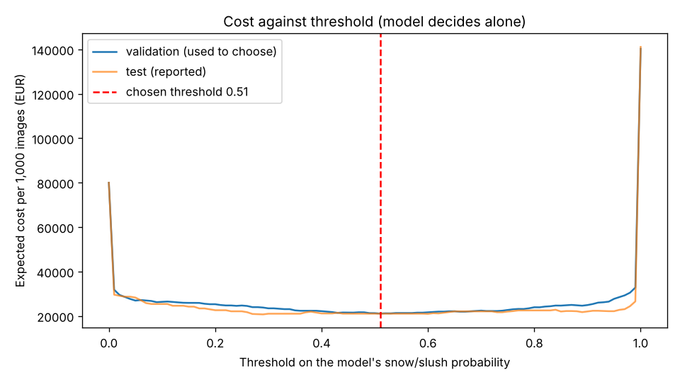

# Assignment 2 Report

> **How to use this draft.** The tables, figures and sources below come
> straight from the pipeline's outputs (`results/`) and `assumptions.json`, and
> are correct for the committed run. Every line marked ✍️ is yours to write in
> your own words; then delete the ✍️ prompt. If you change any figure in
> `assumptions.json`, run `uv run python decision.py` and update the tables in
> the last three sections. Delete this box when done.

- **Name**: Niccolò Pragliola
- **Student ID**: 19873
- **Email**: npragliola.ieu2022@student.ie.edu
- **Group**: BBADBA 5A

## Business problem, and the cost of being wrong

**Decision.** On winter nights, a road-maintenance control room decides for
each stretch of road whether to send a salt/grit truck. The model looks at a
dashcam image of the stretch and gives one of three outcomes: **pass** (do
nothing), **operator review** (a person looks at the image and decides), or
**send a truck**.

- **Scenario size:** one region of a state road network, about 6,000
  lane-miles, split into 1,200 segments of about 5 lane-miles each. Every
  segment is checked once per 2-hour cycle over a 12-hour night, which gives
  **7,200 images a night**.
- **One case** = one image of one segment in one 2-hour cycle.
- **Positive class** = the road *needs treatment*: the image shows **Snow** or
  **Slush**. Negative = **Clear** or **Wet**.
- **False negative:** a snowy road is left untreated for the next 2 hours
  (≈ €800 of expected crash cost, see costing below).
- **False positive:** a truck pass is made on a road that did not need it
  (≈ €65).

✍️ Who acts on the decision today, and how they make it.
✍️ Why a miss is worse than a false alarm, and roughly by how much (about 12
times, from the figures below).
✍️ Why Wet counts as "no treatment needed" in your framing.

## Dataset

- **Roboflow Universe:** workspace `udot-classification`, project
  `udot-winter-road-conditions`, **version 1**, used as published (not forked).
- **Link:** https://universe.roboflow.com/udot-classification/udot-winter-road-conditions/dataset/1
- **Licence:** CC BY 4.0. The example images in `results/examples/` come from
  this dataset.
- **Task:** image classification, 4 classes: Clear, Slush, Snow, Wet.
- **One image:** a frame from a vehicle dashcam driving on winter roads,
  with the car's hood visible at the bottom. 5,232 images are 3840×2160 video
  frames and 1,013 are 640×640 with black letterbox bars.

✍️ Why this dataset serves the decision rather than just resembling it, and
the one way it differs from your scenario (dashcam frames, not fixed cameras).

## What the dataset's composition implies

| Class | Train | Valid | Test | Total | Share taken at night |
|---|---|---|---|---|---|
| Clear | 410 | 117 | 52 | 579 | 24.9% |
| Slush | 762 | 203 | 107 | 1,072 | 9.7% |
| Snow | 2,289 | 678 | 344 | 3,311 | 53.4% |
| Wet | 902 | 263 | 118 | 1,283 | 11.6% |
| **Total** | **4,363** | **1,261** | **621** | **6,245** | |

- Split: 69.9% train / 20.2% valid / 9.9% test, no augmentation applied.
- Positive (Snow + Slush) share: 69.9% of train, 72.6% of test.
- Object size: not applicable, as this is classification and the whole image
  is the case.
- **Night images:** "night" = mean grey level below 45 out of 255. Over half
  of the Snow images are at night, against 10–25% for the other classes.
- **Near-identical frames across splits:** many images are consecutive video
  frames. Comparing a 256-bit fingerprint of every image (a test image counts
  as a twin if it differs from some training image in at most 25 bits), 22.8%
  of validation images and 21.1% of test images (131 of 621) have a
  near-identical twin in train.

✍️ What these imply: Clear has only 52 test images (how much can you trust
its numbers?); night images could let the model learn "dark = snow"; twins
could inflate test accuracy. Say how you checked each one (see the subsets in
the next section).
✍️ How the test split's 72.6% snow differs from real winter nights, and why
that is the reason for the 15% base rate in the costing section.

## Finetuning and baselines

**Model:** `yolo11n-cls` (1.5M parameters), finetuned from its
ImageNet-pretrained checkpoint.

**Where and how it was trained:** a 4-core Intel Xeon CPU (2.10 GHz) cloud
machine, PyTorch 2.11 (CPU build), Ultralytics 8.4.173, Python 3.12. 30
epochs, image size 224, batch 64, seed 0, otherwise Ultralytics defaults
(including its default augmentation). Training took 47 minutes; the full
pipeline took 53. Before training, every image was shrunk to 640 px on its
longest side (labels and splits untouched) because the model only sees 224 px.
The best epoch on validation was epoch 28 (validation top-1 accuracy 0.890).

**Results on the same test split (621 images):**

| Approach | 4-class accuracy | "Needs treatment" precision | "Needs treatment" recall |
|---|---|---|---|
| Finetuned `yolo11n-cls` (threshold 0.51) | **0.907** | **0.967** | **0.978** |
| Majority class: always "Snow" (= always send a truck) | 0.554 | 0.726 | 1.000 |
| Predict nothing (= never send a truck) | – | – | 0.000 |
| Pretrained model, zero-shot (threshold 0.01) | – | 0.750 | 0.911 |

The pretrained model only knows the 1,000 ImageNet labels, so it cannot output
Clear/Slush/Snow/Wet. Its "snow score" is the total probability it gives to
snow-related labels (alp, snowplow, snowmobile, ski, dogsled, bobsled,
shovel). Its most common top labels on the test images were alp (74), snowplow
(70), snowmobile (63), traffic light (60) and car mirror (50).

**Same finetuned model on harder subsets of the test split:**

| Test subset | Images | Accuracy |
|---|---|---|
| All | 621 | 0.907 |
| No near-identical twin in train | 490 | 0.892 |
| Daytime | 388 | 0.889 |
| Night | 233 | 0.936 |

✍️ Why classification and `yolo11n-cls` fit this decision.
✍️ Whether the gap to the baselines is what you expected, and what the subsets
tell you about the leakage and night worries from the previous section.

## Per-class evaluation and failure modes

**Positive class:** "needs treatment" = Snow or Slush.

| Class | Test images | Precision | Recall |
|---|---|---|---|
| Clear | 52 | 0.788 | 0.788 |
| Slush | 107 | 0.812 | 0.850 |
| Snow | 344 | 0.971 | 0.971 |
| Wet | 118 | 0.858 | 0.822 |

**Confusion matrix on test** (rows = actual, columns = predicted):

| Actual \ Predicted | Clear | Slush | Snow | Wet |
|---|---|---|---|---|
| Clear | **41** | 2 | 2 | 7 |
| Slush | 0 | **91** | 7 | 9 |
| Snow | 1 | 9 | **334** | 0 |
| Wet | 10 | 10 | 1 | **97** |

Collapsed to the business decision at threshold 0.51 (test images):

| | Truck sent | No truck |
|---|---|---|
| Actually needs treatment (451) | 441 (TP) | 10 (FN) |
| Actually fine (170) | 15 (FP) | 155 (TN) |

✍️ Which class carries the headline accuracy, which one is dragging, and what
the model confuses with what (Clear ↔ Wet, Wet → Slush, Slush → Wet).
✍️ Which of those confusions actually matter for the decision: a Slush
image called Snow still gets a truck; a Slush image called Wet does not.

## Cost matrix and operating point

**Figures used (`assumptions.json`).** USD converted at about 0.9 EUR per USD.

| Item | Value | Basis |
|---|---|---|
| Truck pass, road needed it (TP) | **€65** | UDOT spends about $1M per storm on 24,000 lane-miles [1], i.e. about $42 per lane-mile per storm. A 5-lane-mile segment is about $210 per storm. Assuming about 3 passes per storm, one pass is about $70, or €65. |
| Truck pass, road was fine (FP) | **€65** | Same truck, salt and driver time, with nothing gained. |
| Snowy road left untreated for 2 hours (FN) | **€800** | Expected crash cost that treating would have avoided. **(a) Cost per crash on snowy pavement ≈ €12,000:** US snowy/slushy pavement averages 174,446 crashes, 41,597 injured and 538 deaths a year [2]. Priced at about $4,200 per property-damage crash and $21,000 per injury crash (2015 values) [3], plus $1.6M economic cost per death [4], that is about $13,000 per crash. **(b) Crashes avoided ≈ 0.07:** assume about 1,000 vehicles over 2.5 road-miles in the 2 hours. The dry crash rate is about 2 per million vehicle-miles (NHTSA 2019: ~6.8M police-reported crashes over ~3.3 trillion vehicle-miles), and snow-covered asphalt is about 15 times riskier [5], so about 0.078 crashes. Salting cuts crashes by about 88% [6], so about 0.07 are avoided. **0.07 × €12,000 ≈ €800.** |
| Nothing done, road fine (TN) | €0 | No action and no harm. |
| Operator review | 15 s at €30/h = **€0.125** per image | Assumption: one glance at one dashcam image; an operator wage plus overheads. |
| Base rate (share of images that really need treatment) | **15%** | Salt Lake City has about 31 days a year with measurable snow [7], about 21% of a 150-day winter. Assume roads are snowy or slushy in about two thirds of the night's checks on those days, giving about 14%, rounded to 15%. |
| Images per night | **7,200** | 1,200 segments × 6 two-hour cycles. |
| Operator capacity | **2,880 reviews a night** | 2 night-shift operators, each spending 6 hours of a 12-hour shift on reviews, at 240 images an hour. |

Sources:
[1] UDOT snow operations, via [ABC4](https://www.abc4.com/news/local-news/udot-snow-removal-what-goes-into-keeping-our-utah-roads-clear/amp/) and [UDOT](https://connect.udot.utah.gov/2023/11/16/udot-snow-plow-operators-are-ready-for-winter/);
[2] [FHWA Road Weather Management, 2005–2014 averages](https://ops.fhwa.dot.gov/weather/roadimpact.htm);
[3] [Nebraska DOT crash cost estimates](https://dot.nebraska.gov:443/media/jygdpzmn/trcostest.pdf);
[4] [NHTSA, Economic and Societal Impact of Motor Vehicle Crashes, 2019](https://www.nhtsa.gov/node/136981);
[5] [Marquette University pavement and accidents study](https://www.eng.mu.edu/drakopoa/web_documents/Wet%20pavement%20MU%20report/PCC%20and%20asphalt%20pavement%20texture%20relation%20to%20accidents.pdf);
[6] [Kuemmel & Hanbali (1992), Accident Analysis of Ice Control Operations](https://epublications.marquette.edu/transportation_trc-noise/3/);
[7] [Climate of Salt Lake City](https://en.wikipedia.org/wiki/Climate_of_Salt_Lake_City).

✍️ In your own words: which of these figures you trust most and least, and why.

**How the expected cost is computed:** on the validation split, measure for
each threshold what share of snowy images and what share of fine images get a
truck. Weight those shares by the base rate (15%), not by the dataset's 70%
snow, and multiply by the costs to get euros per 1,000 real images. Thresholds
from 0.00 to 1.00 in steps of 0.01 are tried, and the cheapest one is chosen.
It is chosen on validation and reported once on test.

- **Chosen threshold (model decides alone): 0.51.** Expected cost on test:
  €17,070 per 1,000 images.
- **Cross-check:** a truck is worth sending when P(snowy) × €800 > €65, i.e.
  P(snowy) > 0.08. The model was trained on 70% snow, so its score overstates
  real-world P(snowy). Converting 0.08 into the model's score scale gives
  **0.54**, close to the 0.51 the sweep found.

**Sensitivity** (one figure changed at a time; threshold re-chosen on
validation, priced on test; full table in `results/sensitivity.csv`):

| Changed | Value | Best threshold | € per 1,000 (model alone) |
|---|---|---|---|
| Missed snowy road | €200 | 0.90 | 12,823 |
| Missed snowy road | €400 | 0.53 | 15,739 |
| Missed snowy road | **€800 (used)** | **0.51** | **17,070** |
| Missed snowy road | €1,600 | 0.43 | 20,055 |
| Missed snowy road | €3,200 | 0.05 | 23,793 |
| Truck pass | €32.50 | 0.43 | 10,028 |
| Truck pass | €130 | 0.53 | 31,478 |
| Truck pass | €260 | 0.90 | 51,290 |
| Base rate | 5% | 0.53 | 9,513 |
| Base rate | 25% | 0.43 | 24,913 |
| Base rate | 40% | 0.05 | 35,828 |

The threshold stays between 0.43 and 0.53 while the miss cost is €400–1,600,
the truck pass €32.50–130 and the base rate 5–25%. It jumps to 0.90 once a
miss costs less than about 3 truck passes (miss €200, or truck €260), and
falls to 0.05 when misses become very expensive (€3,200) or snow is common
(40%).

✍️ The assumption that would most change your answer, and the value at which
it flips ("the answer changes if X drops below Z").

## What a person still has to check

**Thresholds (chosen on validation within the operators' capacity):** pass
below **0.03**, send a truck from **1.00**, operator review in between. In
practice the operator confirms almost every truck, and the model clears the
images that are obviously fine.

| On the test images | Pass | Operator review | Send a truck |
|---|---|---|---|
| Actually fine (170) | 129 | 41 | 0 |
| Actually needs treatment (451) | 1 | 421 | 29 |

At the 15% base rate, **34.5%** of images go to an operator: **2,484 a
night**, 15 s each, **1.7 operators** of 6 review hours. That is within the 2
available (capacity 2,880).

**Priced on the test split, per 1,000 images:**

| Policy | € per 1,000 | Reviewed | Operators | Missed snowy /1,000 | Needless trucks /1,000 |
|---|---|---|---|---|---|
| Perfect model (reference) | 9,750 | 0% | 0 | 0 | 0 |
| Do nothing | 120,000 | 0% | 0 | 150 | 0 |
| Send a truck everywhere | 65,000 | 0% | 0 | 0 | 850 |
| Operator checks every image | 9,875 | 100% | 5.0 | 0 | 0 |
| Pretrained model, zero-shot, alone | 64,053 | 0% | 0 | 13.3 | 685 |
| Finetuned model alone | 17,070 | 0% | 0 | 3.3 | 75 |
| **Finetuned model + operator review** | **10,038** | 34.5% | 1.7 | 0.3 | 0 |

Per night (7,200 images), that is about €72,300 for model + review, €122,900
for the model alone, €71,100 if an operator checked everything (needing 5
operators instead of 2), and €864,000 for doing nothing.

✍️ Is 2,484 reviews a night with 2 operators realistic? What happens on a
heavy snow night, when far more images are uncertain?
✍️ Compare your design with the three alternatives (do nothing, a person
checks everything, model alone), and say why "a person checks everything" is
not the answer even though it is slightly cheaper per image.
✍️ Why the operator ends up confirming almost every truck: a review costs
€0.125 and a needless truck pass €65.

## Limitations & next steps

✍️ Real limitations, each with a concrete fix. Candidates from the results:
dashcam frames rather than fixed cameras; one region and one season; near-twin
frames across splits; only 52 Clear test images; the miss cost rests on an
assumed traffic volume; the operator is assumed always right; each image is
treated as independent of the segment's previous checks.

## Generative AI use disclosure

✍️ What AI did and what you did. Facts to include: an AI assistant (Claude)
suggested the topic options and the dataset, wrote the pipeline and dashboard
code, executed the training run, and proposed the cost figures with their
sources. Say which decisions and analysis are yours.
